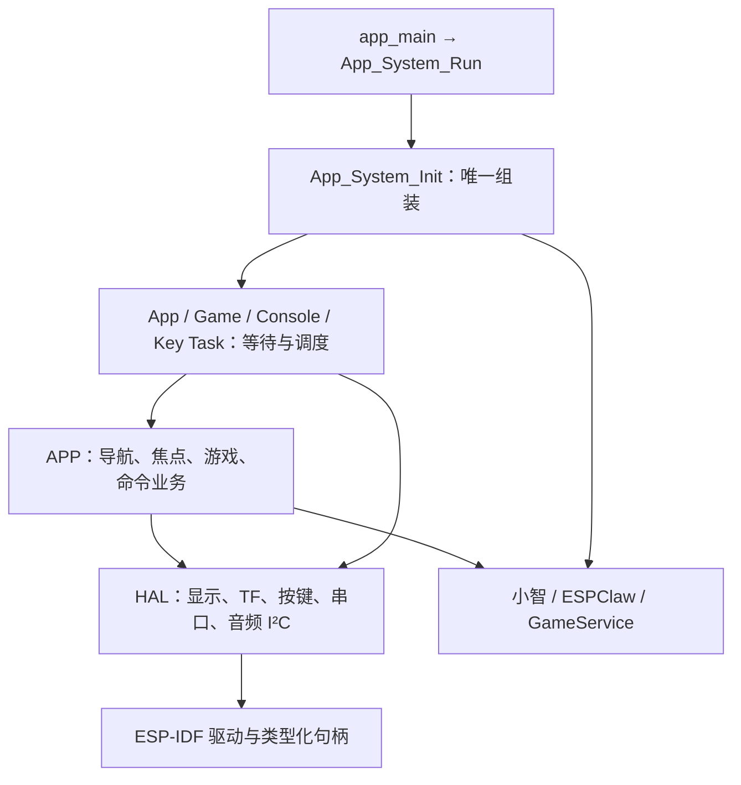

# 系统架构

自有硬件采用直接 HAL → APP 调用；APP 管理业务流程和状态机，Task 管理等待与调度。命名沿用大驼峰加下划线。组件名保留用户指定的 `compoment` 拼写。

此调整依据用户 2026-10-02 的要求与[新架构 skill](../skills/embedded-hal-app/SKILL.md)，不再要求每个外设使用函数指针、硬件绑定写在 APP 或一次/二次业务强制分层。参考了 Espressif ESP-BSP、ST HAL 和 Zephyr 的公开实现；具体取舍见[设计依据](../skills/embedded-hal-app/references/design-decisions.md)。

## 文件与调用入口

| 文件 | 入口和拥有者 |
|---|---|
| `main/app_system.cc` | `App_System_Init/Run`，组装现有真实服务；唯一 Wi-Fi/音频所有者仍是小智 |
| `board_support/hardware/hal_display.cc` | `Hal_Display_Init/Flush`，UI 独占 SPI/DMA，失败清理，缓冲排空后复用 |
| `board_support/hardware/hal_storage.cc` | `Hal_Storage_Mount/Is_Mounted/Mark_Failed`，SDMMC 和只读系统分区，重挂由 APP 串行化 |
| `board_support/hardware/hal_key.cc` | `Hal_Key_Init/Read/Scan`，低有效/20 ms 去抖，不持有业务回调、不创建任务 |
| `board_support/hardware/hal_uart.cc` | `Hal_Uart_Init/Read`，UART0 RX；stdout/日志继续拥有 TX |
| `board_support/hardware/hal_audio_bus.cc` | `Hal_Audio_Bus_Init/Get`，有类型 I²C 句柄借给固定 ES8311 codec |
| `mosicrokey_app/app.cc` | `Page_Change_Process`、`Key_Press_Process`、`Command_Process`、`Navigation_Update_Process`、`Game_Update_Process`，完整业务状态机 |
| `mosicrokey_app/console.cc` | `Console_Command_Process`，保留现有命令/结果协议，串口等待不在此文件 |
| `mosicrokey_app/task/*.cc` | `App_Task`、`Game_Task`、`Key_Scan_Task`、`Console_Task` 及创建函数 |
| `board_config.hpp` / `task_config.hpp` | 唯一板级参数 / 项目任务栈、优先级、周期、核与队列容量 |

HAL 不依赖 contracts/APP、没有 GPIO/PWM 操作表和注入工厂。APP 可调用 HAL 以及真实服务；按键采集和 UI 刷新任务可直接调用 HAL，避免只为层级增加无意义转发。

小智 Board/Display/Codec 的虚函数是上游要求；ES8311/I²S、BOOT 与 RGB 继续用固定上游驱动，避免重复外设拥有者。现有服务接口用于真实上游隔离和主机错误注入，保留在服务边界；APP 的私有 context 隐藏任务句柄与受锁状态，不用于硬件函数指针注入。业务纯数据头与硬件 SDK 类型分开。

| 组件 | 职责 |
|---|---|
| main | 唯一 app_main，调用 App_System_Run；app_system 明确组装与启动 |
| mosicrokey_contracts | Result、请求/事件、状态、焦点策略与服务接口；无 LVGL/FreeRTOS/GPIO/上游私有类型 |
| mosicrokey_app | 固定容量命令队列、导航、前台仲裁、串口用例 |
| xiaozhi_compoment | 真实小智应用/协议/音频/配网，唯一 MosiCrokey Board，显示事件桥接 |
| espclaw_compoment | 真实 claw_core 请求与工具循环、上下文/记忆/技能/路径、NVS 模型配置与六游戏能力 |
| game_service | 包校验、版本库、安装、RGB565 资源和受限 Lua VM |
| mosicrokey_ui | 唯一 LVGL 上下文、共享页面 Presenter 与游戏画布 |
| board_support | S31 配置和五个直接 HAL 实现：SPI TFT、SDMMC、按键、UART、音频 I²C |

## 执行与资源

App 使用 12 项固定操作队列，队列满返回 Busy；状态与帧按最新值合并。上游事件更新受保护的状态，不访问 LVGL 对象。游戏异常通过合并故障槽回传，队列拥塞不会丢失退出；游戏代次检查避免已停止的帧误导航。

v0.2.0 游戏库刷新采用合并标志，发布完成不会因操作队列满而丢失。App/Game 任务先等待启动通知，全部创建成功后才开始工作；部分创建失败释放门控中的任务和队列，可重试。`Game_Read_Source` 与重挂/示例安装/Agent 提交使用同一存储操作锁，避免读取时卸载。

显示完成通知等待为 1 s，SDK 提交及超时后的排空可能继续等待；不能宣称整个刷新函数有 1 s 上限。排空失败时 `ESP_ERROR_CHECK` 明确终止，避免把仍由 DMA 持有的像素交回 LVGL。存储卸载先移出 card 所有权，因为本机 SDK 可能先释放 context/card，再返回路径注销错误；失败不保留悬空句柄。

所有 LVGL 对象更新仅在 UI 任务执行。SPI 两个 6400 B DMA 缓冲从内部内存分配；画布、Lua 自定义堆与其他大块分配优先 PSRAM。模型请求不在 UI/音频任务等待。游戏与库使用不同锁，后台校验/安装不锁住正在运行的 VM。

| 新增任务 | 栈（ESP-IDF 字节） | 优先级 | 核 |
|---|---:|---:|---|
| UI | 8192 | 3 | CPU0 |
| 按键扫描 | 4096 | 3 | 无固定核 |
| App 状态机 | 8192 | 2 | 无固定核 |
| 游戏 | 8192 | 3 | CPU1 |
| UART 命令 | 8192 | 1 | 无固定核 |
| claw_core | 16384 | 1 | CPU0 |
| Agent 结果接收 | 6144 | 1 | 无固定核 |

保留上游音频任务参数和主循环优先级。App 定期记录内部/PSRAM 空闲、最低堆和任务栈水位；游戏输出帧率。30% 栈余量、两小时无增长及并发帧率是设备验收目标，主机测试没有证明这些目标。

2026-10-02 同一 v0.1.9 在 USB 游戏与后台模型请求范围完成独立7201.29秒：项目任务最低空闲栈51.07%至89.45%，最低/平均30.3FPS；24请求中3次自然断网连接错误，自动恢复后连续4次成功，游戏未离开前台。完整堆采样和联网空闲趋势见当日实板记录；这些结果不覆盖小智完整语音或实体TF/屏幕/按键。

v0.1.2 将 UI、Agent 和 TCP/IP 固定在 CPU0，游戏固定在 CPU1，减少模型请求对 10 ms Lua 帧预算的抢占影响。小智激活任务仍可能在 CPU1，但优先级 2 低于游戏；音频输入 8、输出 4 保留上游设置。无固定核任务的诊断可能显示当前核或 NoAffinity，不能据此认为所有网络任务均被隔离。

FreeRTOS tick 为 1000 Hz，保证 5 ms 扫描与 UI 等待不会向下取整为零；BSP 有编译断言。串口周期与游戏 33 ms 周期按同一时基转换。

## 小智适配

排除原 app_main 与板工厂，显式选择 S31 所需的应用、音频、协议、Wi-Fi Board 等源文件。Board 使用独立 `mosicrokey-s31` 身份，Display 只发布服务事件。跨任务操作通过 Application::Schedule()。

初始化小智的唯一 Wi-Fi/网络栈后，再启动 App 网络状态轮询；ESPClaw 不初始化 Wi-Fi。离开小智页面时立即撤销音频门控，调度停止录音/音频测试、取消对话、关闭音频通道、关闭唤醒并清空解码。迟到的 TTS 和解码也检查焦点。

保留标准激活与协议协商；产品编译关闭固件自动升级及主动升级入口。语言配置、音频资源和模型 assets 在 build 中生成，项目不依赖上一个工作目录。上游修改见[补丁说明](../patches/README.md)。

## ESPClaw 适配

采用上游真实 claw_core 的兼容 API、16 轮最大工具迭代、请求编号与取消机制。通过 claw_cap 注册 game 组六个工具（五个 TF 工具及 USB 临时预览），只将该组暴露给模型。请求开始时提供游戏技能、完整样例、会话与工具定义；同一请求首次校验失败后最多三次修正。

专用 NVS `mosi_agent` 保存 url/model/key；日志不显示 key，配置期间忙碌时拒绝修改。TF 上 `/sdcard/agent` 保存上游记忆/会话和技能状态；系统技能来自只读 `/system/skills`。缺卡/保存失败时降级为最多 8 条、16 KiB 的临时对话。

v0.1.5 通过公共 AgentIntent 区分普通对话与游戏发布。`ask` 保留普通会话；`gameask` 的初始会话仅包含本次 USER，现有游戏由 game_list 读取，本轮真实工具结果仍由 Core 追加。旧会话不删除。此隔离避免旧候选分析和伪调用文本影响本次提交，但不能保证模型一定调用工具。完成结果以真实 game_preview/game_commit 成功记录为准；没有发布则明确失败，已经发布后的后续模型错误仍保留发布事实。

关闭上游 HTTP 原始错误正文日志，返回设备 UI/串口前遮蔽配置密钥，防止服务错误回显凭证。

game_list 支持读取现有游戏清单及 main.lua 的 4096 B 分页，修改时保留原 ID 并创建新版本，已有资源复制到新暂存任务。

HTTPS 请求采用可取消的非阻塞轮询；工具已成功发布游戏但后续模型总结失败时，完成结果同时保留发布事实与真实错误。普通错误不会撤回已经提交的版本。USB 预览只保留于内存，界面和工具结果明确标记临时，TF 存储状态保持独立。

## 游戏与退出

业务通过 IGameLibrary/IGameRuntime 调用安装、枚举、运行、输入和 Tick。VM 在启动时读入源码及资源，后续渲染不读 TF。返回键由固件处理，退出释放 VM 与资源，回到游戏库；运行中的版本不被后台提交替换。

校验、安装协议和受限 API 见[游戏 API](game-api.md)。存储与源码校验使用校验和检测损坏，不宣称具备包签名或来源认证。

