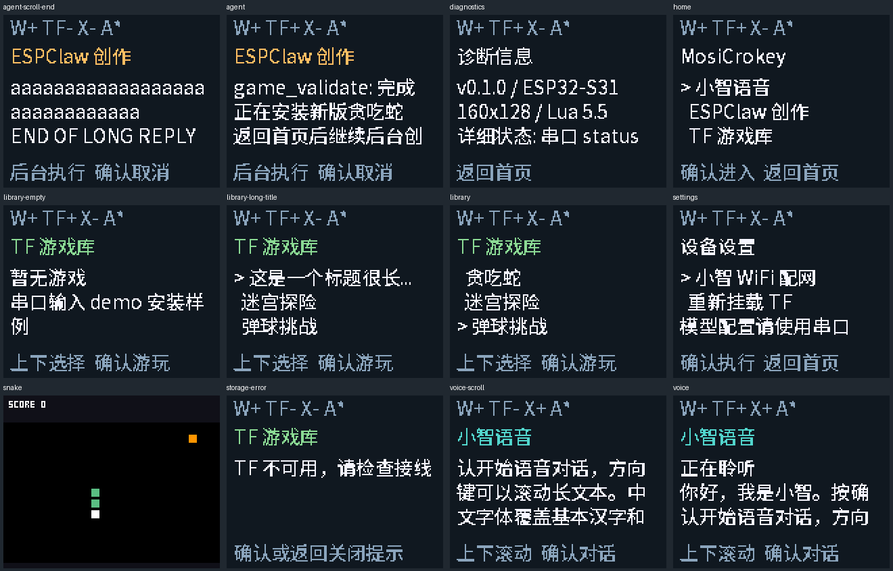

# v0.1.0 软件验证记录

日期：2026-10-01（Asia/Shanghai）。目标 ESP32-S31-Function-CoreBoard-1 / esp32s31，SDK ESP-IDF 6.1.0。

## 结论

S31 目标构建及独立目录重建通过，最终默认配置与两个构建配置完全一致。主机三项测试全部通过：614 个游戏/协议检查、421 个业务/焦点/密钥遮蔽检查，共 1035 个检查；共享页面捕获 12 个状态并完成截图检查。

已验证的是可编译固件和主机可执行行为。没有识别到目标板串口，没有有效服务配置，没有烧录或执行真实 AI 与设备稳定性测试。

## 发布镜像

文件：`release/mosicrokey-v0.1.0-esp32s31.bin`，16777216 B，完整镜像烧录偏移 0x0。

SHA256：`446c3c8e58ad7237cf64c1121ccb1991bc134a6ffe7f8a04a2a5d301f35c0997`

应用 3898144 B，应用分区 6291456 B；语音 assets 561011 B，分区 8388608 B；system FAT 镜像 524288 B，与分区等大。完整镜像含空白 NVS，首次/工厂烧录会清除配网及模型配置。普通构建分区烧录保留 NVS。

镜像带构建元数据，哈希以发布清单为准。对应 ELF、分段哈希和配置在 release。源码快照、默认配置、应用/测试源码指纹见下列记录。

## 实际执行与证据

| 检查 | 内容与记录 |
|---|---|
| 主构建 | scripts/build.ps1；[构建日志](build.log) |
| 独立重建 | build-repro / 独立 sdkconfig；[首次完整构建](repro-build-from-defaults.log)、[1000 Hz 配置重建](repro-tick-config-build.log)、[最终构建](repro-final-build.log) |
| 默认配置核对 | 最终 defaults 重新生成配置，与发布及重建配置比较无差异；[配置日志](fresh-config.log)、[比较结论](config-comparison.log) |
| 主机测试 | scripts/test-host.ps1；[构建及 CTest](host-build-and-tests.log)、[详细输出](host-tests-detail.log) |
| 固件检查 | 唯一 app_main/create_board、真实 Application::Run/claw_core_submit、分区容量、完整镜像每一分段与原文件逐字节相同、工厂 NVS 空白；[检查日志](firmware-check.log) |
| 源码 | verify-sources.py 校验 2960 个文件；[项目代码/配置/测试 SHA256](code-sha256.json) |
| 汇总数据 | [结构化结果](result.json) |

游戏检查覆盖：焦点全组合、路径限制、校验/提交顺序、损坏版本回退、未提交版本忽略、修订不覆盖、源码分页、资源解码/继承、受限库/内建元表、初始化及每帧超时、绘图预算、堆耗尽、确定性输入回放、100 次加载退出以及五次后台安装时持续渲染。

业务测试直接编译真实 App actor，用主机调度/硬件替身验证：100 次音频焦点切换、请求跨页保留、忙碌重挂保护、读卡失败与恢复、游戏输入/停止竞争、异常返回及饱和队列 Busy。Agent 配置密钥在错误正文中多次出现时会被遮蔽。真实 HTTP、NVS、DMA、音频或硬件时间预算没有由这些替身验证。

## UI 检查

同一 LVGL 9.5.0 页面源码和项目中文字体渲染为 160×128 RGB565，再转换 PNG。截图覆盖主页、小智、Agent、游戏库、设置、诊断、贪吃蛇，以及空库、缺卡、长标题、语音滚动和长回复尾部。

列表为三行可见窗口，长标题省略，长回复能滚动到末尾；状态栏显示网络、TF、小智前台焦点和 Agent 工作状态。截图显示的是主机渲染，不是 ST7735 实物照片。

## 剩余设备验收

连接目标板、屏幕、TF 四线模块、六按键和扬声器，确认 COM 与 Flash/PSRAM 后烧录。配置真实服务后依次完成小智语音、ESPClaw 生成/修改并游玩、TF 重启持久化、故障恢复和并发；再测两小时、设备 100 次切换/加载、至少 30% 栈余量和 30/20 FPS 目标。

详细通过条件见[验证计划](../../verification-plan.md)，操作见[开发指南](../../development-guide.md)。硬件通过结论必须补充对应镜像哈希与设备日志。
