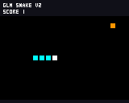

# MosiCrokey v0.1.9 USB 实板闭环记录

目标板 ESP32-S31-Function-CoreBoard-1，COM8 / Silicon Labs CP210x，ESP32-S31 rev0.0；16 MiB Flash、16 MiB Octal PSRAM（200 MHz）、CPU 320 MHz。当前只接 USB，没有 TFT、TF、外接按键或扬声器。整机验收未完成。

## 固件与证据

v0.1.9 应用 SHA256：`d5d21736728c7367eadec04d994e30f9c65d4f9babef3e61b0d5c520d885a869`。工厂镜像 SHA256：`1de462ffbce70176ebe870dd5634d019ec10889d5b6c5b47631bf07f69f9f58f`；ELF：`c5de7948aa44dc2f0723155e67771302e9ca7640024faba8ca19b70ca10e30ea`；来源清单：`a824a09761db5f8ba8440b9904703a43d035b51712bc00b1f7411594167362a8`。

应用为 3911936 B，适配 6 MiB 分区。实板普通分区烧录保留 NVS；工厂镜像包含空白 NVS，会清除网络与模型配置。源码快照、小补丁和锁定依赖均在工程内，构建不依赖原目录。

精选证据及哈希见 [evidence/record.json](evidence/record.json)，完整日志在工程 `logs/hardware-2026-10-01/round-001`。历史记录分别保留为 [v0.1.3 中断](evidence/record-v013-interrupted.json)、[v0.1.5](evidence/record-v015.json)、[v0.1.7](evidence/record-v017.json)、[v0.1.8](evidence/record-v018.json)。旧版结论不自动归于当前固件。

## 当前真实结果

| 范围 | v0.1.9 结果与证据 |
|---|---|
| 构建与来源 | S31 完整构建、唯一 app_main/Board、真实 Application/claw_core 符号、分区及合并检查通过；六个补丁文件反向应用恢复固定上游字节哈希；build-v019-final.log / package-v019.log |
| 主机 | 632 游戏 + 448 App + 50 实际 OpenAI 后端 + 48 实际 HTTP 传输 = 1178 检查；3 项长测脚本故障注入；host-v019-final.log |
| 共享 UI | 13 个共享 LVGL 状态重新渲染与检查；[联系表](evidence/ui-v019/contact-sheet.png)。不能代替实体屏验收 |
| 启动 | v0.1.9、Flash/PSRAM、ES8311 reset/init、DHCP 成功；重启后网络和模型配置保留；v019-boot.log |
| 小智 | 标准 OTA/激活 HTTPS 可达，独立产品身份；等待用户账号绑定，未完成真实对话及声学播放 |
| 普通请求 | 板载真实 claw_core + GLM-4-Flash-250414 request=1 成功；v019-recovery-first.log |
| 取消恢复 | 请求 2/3/4 在不同阶段取消，控制日志接收取消到完成约 1182/11/10 ms；请求 5 正常恢复。连接早期仍由 SDK 管理，100 ms I/O 轮询不能当作全链路取消保证；v019-cancel-*.log |
| 原生发布 | request=6 实际 game_preview result=0，发布 V2/p1；request=7 在游戏运行期间发布 V3/p2，completed status=0；v019-publish-v2.log / v019-publish-v3.log |
| 源码与玩法 | 重新发布 v0.1.5 板载 AI 修复的 V3；设备导出 2832 B 与已验证源码逐字节一致，32 项受限 VM 回放通过；v019-device-v3-p2.lua / v019-device-v3-probe.log |
| 运行版本隔离 | 后台发布 V3 后运行中的 V2 保持青色；退出重进后 V3 为绿色且 SCORE 1；实际 VM 画布 128 行及 FNV 校验通过，96947c9d / 923aa425；v019-v2-after-v3-frame.log / v019-v3-active-frame.log |
| 发布真实性 | request=8 只用文字声称已发布；backend_status=0，产品 status=1，提示未发布游戏；没有执行文字工具或产生新版本；v019-no-publication*.log |
| 鉴权恢复 | request=9 实际 HTTP 401；恢复配置后 request=10 成功，游戏继续运行；v019-invalid-key*.log / v019-auth-recovery*.log |
| 设备 VM 与无卡 | 自检 60 帧/100 次加载：init 7900 us，帧均 1944 us/最高 2562 us，超时/堆/禁用库 PASS；无卡重挂报告 TF: ESP_ERR_TIMEOUT，demo 返回 TF card unavailable，游戏仍可运行；v019-selftest.log / v019-no-tf.log |
| 音频焦点 | 非语音页 focus=0、input/output disabled、playback_idle=1、输入输出计数 0；仅证明门控；v019-selftest.log |
| 连续运行 | 100 次加载退出/600 条导航命令完成；连续记录 6004.97 秒（约 100 分钟），19 次请求成功、1 次 DNS 失败后恢复，无未完成请求，稳定最低/均值 30.3 FPS。串口 ClearCommError 拒绝访问后中断，未通过两小时；soak-v019-interrupted-*.json/log |

V3 源码 SHA256：`54df1351ba60b757d340e16787566acfe7433aea7b4c83c687c612860b00b8d7`。32 项检查涵盖计分/食物、方向/防倒退、穿墙/自撞、确认重开、满屏胜利、有界找食物和同一步两次转向。满屏/拥挤场景使用追加测试夹具，属于实际源码的主机回放。

## 迭代原因与历史限制

- v0.1.1 后台网络活动曾触发绘图墙钟预算；v0.1.2 隔离游戏至 CPU1 / 优先级 3，UI/Agent/TCPIP 在 CPU0。音频参数保留，10 ms 帧预算与指令限制未放宽。
- 初次 AI 游戏虽通过语法探测，仍有食物/得分/转向缺陷；真实模型修复后逐字节导出。v0.1.6 将经过 32 项检查的 V3 用于 demo、Agent 参考和设备自检。
- v0.1.5 增加 gameask 发布意图及真实工具判定；创作初始历史只含当前 USER，普通聊天保留有界历史。仅打印 JSON/声称成功不算发布。
- v0.1.7 取消约 13.77 秒，恢复请求因仍忙被拒绝；未通过取消恢复。v0.1.8 将连接后的单次 I/O 限为 100 ms，改善取消，但恢复实测失败为 ESP_ERR_HTTP_WRITE_DATA。
- v0.1.9 仅对已发完请求头、同一异步 POST 正文未完成状态的 WRITE_DATA 继续轮询，保留 SDK 发送偏移。请求头、关闭状态与负值写错误保持失败，不重放整个 POST。48 项实际传输源码故障注入和真实请求验证这些边界。
- v0.1.3 记录 4623.23 秒连续游戏、100 次加载退出、16 次背景请求成功、30.3 FPS；ClearCommError 拒绝访问后中断，设备后来重新启动，未捕获事发复位原因。不能判断固件崩溃或人为拔插，不能算两小时通过。另两轮约 1.6 秒和 1333 秒，同样是部分结果。
- 当前长测线程临时防自动休眠，检测主机监视间隙和设备运行时间倒退，退出恢复电源状态。手动休眠、拔插与电脑异常仍会使连续测试失效。

## 待实测范围

小智账号绑定、真实录音/播放/中断、实体屏/按键、TF 安装/重启持久化/拔卡/空间不足及完整语音并发仍待验收。USB 游戏重启丢失，电脑源码归档不等于 TF 持久化。非语音页 focus=0、输入/输出禁用只证明门控，不证明声学录放。

## 服务来源

[智谱官方价格表](https://docs.bigmodel.cn/cn/guide/start/pricing)列出 GLM-4-Flash-250414 与 GLM-4.7-Flash 免费；当前采用 `glm-4-flash-250414`。OpenAI 兼容基址 `https://open.bigmodel.cn/api/paas/v4`，原生 tools / Bearer。没有使用 FlashX 或付费 GLM-4.7。

2026-10-02 重连：COM8、相同 CP210x 身份，板上仍为 v0.1.9；当前复位原因 1，request=0/games=0，说明设备已重新启动。该重连状态不能确定上一轮串口中断当时的复位原因。新的验证保存在 logs/hardware-2026-10-02/round-001，时长不与旧轮合并。
