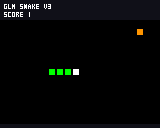
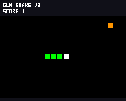

# 2026-10-02 v0.1.9 重连闭环验证

当前仅 USB 连接，COM8 / 同一 CP210x 适配器。板上固件 v0.1.9，应用 SHA256：`d5d21736728c7367eadec04d994e30f9c65d4f9babef3e61b0d5c520d885a869`。Git 仓库为 [linxi27667/esp_mosicrokey](https://github.com/linxi27667/esp_mosicrokey)，私有，main。

## 已实测

- 重连时 reset_reason=1、uptime=239972 ms，request=0/games=0；设备已经重新启动。不能据此确定上一轮中断当时的复位原因。
- Wi-Fi 配置保留并连接 Ll；普通 GLM 请求 1 成功，回复重连恢复成功。
- 模型为 glm-4-flash-250414；2026-10-02 核对[智谱官方定价](https://docs.bigmodel.cn/cn/guide/start/pricing)，GLM-4-Flash-250414 输入和输出均标为免费。本轮没有改用 FlashX 或付费模型。
- 原生 ESPClaw 请求 2 通过 game_preview result=0 发布已验证 V3/p1，completed status=0。源码来自先前板载 AI 修复版本，本轮通过真实工具重新发布。
- 从设备导出 2832 B，与参考源码逐字节一致，SHA256 54df1351ba60b757d340e16787566acfe7433aea7b4c83c687c612860b00b8d7；32 项同一受限 VM 玩法回放通过。
- 进入游戏 mode=4；实际 160×128 VM 画布 128 行/FNV 校验通过，923aa425，可见绿色蛇身和 SCORE 1。不是实体屏照片。

## 独立两小时长测结果

2026-10-02 约 02:01:46 至 04:01:47，独立连续游戏 7201.29 秒完成，USB 运行时验收通过。此前 100 次加载退出、600 条页面导航命令全部完成。稳定阶段 715 个 FPS 采样的最低值和平均值均为 30.3；未捕获 panic、复位或看门狗故障，设备 uptime 保持递增。上一轮约100分钟因串口访问失败中断，保留为[历史部分结果](../hardware-2026-10-01/README.md)，没有合并时长。

| 项目 | 实际结果 |
|---|---|
| 后台 API | 24 次：21 成功、3 连接失败、0 未完成；不能称为全部请求成功 |
| 自然断网与恢复 | uptime 5773822 ms 断连，重连失败 reason=201，扫描未发现保存的 SSID；6714342 ms 自动重新获得 IP，间隔 940.52 秒，无人工复位或配置修改 |
| 错误处理 | 请求 20/21/22 明确返回连接失败，游戏保持前台；恢复后 23/24/25/26 连续成功。中断的物理原因未知 |
| 内部空闲堆四段中位数 | 178319 / 178355 / 178351 / 184091 B；末段包含断网导致的网络缓冲释放 |
| PSRAM 空闲四段中位数 | 16430040 / 16431140 / 16432044 / 16432880 B |
| 联网且 Agent 空闲的首末各10采样 | 内部堆中位数 178365 → 177843 B（-522 B）；PSRAM 16426768 → 16431026 B（+4258 B）。未观察到持续单向下降，不能据此保证任意时长或完整语音场景无泄漏 |
| 瞬时最低余量 | 内部 59500 B、PSRAM 16338548 B；与相同空闲条件的趋势分别记录 |
| 项目任务最低空闲栈 | UI 51.07%、App 56.10%、Agent 64.01%、Console 66.55%、Game 71.83%、Agent RX 85.29%、Keys 89.45%，均高于30%；音频处于门控空闲，未验收完整语音栈使用 |

长测后退出并重新启动 p1，mode=4、wifi=1、busy=0、uptime=8016183 ms；导出源码与测试前逐字节相同。画布128行与 FNV 校验通过，b795dc25，绿色蛇身、SCORE 1 可见；与前图校验值不同是截取的运行时位置不同。音频 focus=0、输入/输出帧计数为0，仅证明门控状态。

精选证据中包含完整长测串口日志、最终摘要、分析和 CSV。脚本运行通过范围为游戏/导航/后台 API 错误处理及恢复，整机完整功能验收仍未完成。

精选脱敏文件及 SHA256 见 [evidence/record.json](evidence/record.json)。原始记录在 logs/hardware-2026-10-02/round-001。主机1178检查及13共享UI状态属于同一固件的先前软件基线，见[前轮证据](../hardware-2026-10-01/README.md)，本次没有把它们重新称为新的设备测试。

小智仍等待账号激活，真实语音、实体屏/按键、TF安装与重启持久化、完整语音并发尚未验收。USB预览重启丢失，电脑源码归档不是TF持久化。

源码与固件将以 v0.1.9 预发布交付；应用镜像 SHA256 与本报告一致。源代码基线 96431996322a2dd72048bfb2e54c53f5debb45ca，至本轮结论没有更改编入固件的源码。本轮仅补充验证和交付文档。
