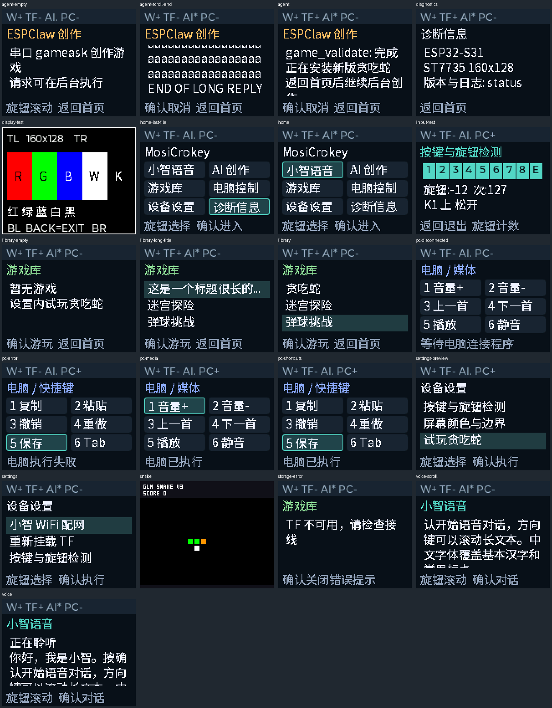
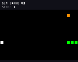

# v0.2.1 屏幕与输入验证

2026-10-02，源码提交 `de91bae778c9b3fc86ac9901b3078d4885f12f57`。本轮交付 ST7735 页面、八键与带按压编码器业务、电脑 UART 配套程序、输入检测/颜色校准及设置内贪吃蛇预览。硬件只接 USB；所有触点、实体显示及电脑实际键控保留待验收。接线和操作见[接入指南](../../tft-input-guide.md)。

## 镜像与构建

ESP-IDF v6.1，target `esp32s31`。应用 3,935,520 B，位于 0x20000，6 MiB 分区余 37%。应用 SHA256：`bfcb3680f4c843ed197196038138912126163af8d6aa903c3eb101c61d1eb1dd`；ELF SHA256：`f19099168c3ef5e2f9d7f8567dcb7d0309d7773c283393984c96f74efb282b1a`。本地文件为 `build/mosicrokey.bin` / `build/mosicrokey.elf`，二进制不放进源代码 Git。

[构建日志](evidence/build.log)通过分区检查；[ELF 符号](evidence/symbols.txt)确认唯一 `app_main`、唯一 `create_board()` 及真实 `Application::Run()` / `claw_core_submit`。上游 2960 文件和六个补丁验证通过，固定版本保持不变。62 个项目源码/配置文件逐字节匹配上述提交；源文件、镜像与全部证据的哈希见 [record.json](record.json)。

## 主机回归与界面

| 编译实际源码的范围 | 通过断言 |
|---|---:|
| 按键与 UART HAL | 61 |
| 编码器 HAL | 30 |
| TF HAL | 22 |
| 显示 HAL | 33 |
| 游戏库、恢复、沙箱与回放 | 639 |
| 模型后端与 HTTP 传输 | 50 + 48 |
| APP、Console、焦点与输入 | 527 |
| 合计 | **1410** |

[主机日志](evidence/host.log)：九个 CTest 全部通过，三个串口长测脚本故障用例通过。电脑连接程序最终[11 项回归](evidence/pc-bridge-tests.log)另行保存；主机总日志内的十项是添加最后一项读内暂停回归前的结果。边界包括重复/陈旧序号、无效字段、释放修饰键、部分 SendInput 失败、电脑暂停前后及读取期间的旧帧丢弃、设备重启换会话，不执行真实 OS 键操作。

共享 LVGL 实际渲染 21 个状态，颜色与边框另有 7 项像素检查；中文、长文本滚动、长标题省略、空库、错误与焦点已检查。

一次 APP 回归因 Windows 调度延迟使固定时刻断言先于任务处理 ACK 超时触发，改为有界等待最终条件后完整回归通过；未放宽固件租约或 ACK 期限。CRLF 源文件按仓库字节保持规则检查，`git -c core.whitespace=cr-at-eol diff --check` 通过。

## COM8 实板冒烟

[识别记录](evidence/chip.log)：CP210x VID/PID `10C4:EA60`，序列号 `7E6E5CC2F471F011A32BFB9E1045C30F`，ESP32-S31 rev0.0，MAC `1c:29:04:d0:78:bc`。[正常分区烧录](evidence/flash.log)校验成功，保留 NVS，没有整片擦除。复位后[启动日志](evidence/boot.txt)报告 v0.2.1、16 MiB Flash / PSRAM，PSRAM 自检、保存的 Wi-Fi 连接和 ES8311 初始化成功。缺 TF 返回超时；小智仍提示用户激活，绑定码从 Git 证据中移除。

`scripts/device-input-smoke.py` 在实际固件注入输入并使用真实电脑协议 Dispatcher，回传明确的模拟 ACK。[33 项结果](evidence/input-smoke/result.json)全部通过：

- 八键及编码器按压的按下/释放掩码、旋转正负计数；颜色页和返回设置。
- 媒体六键、旋钮正反转/按压、快捷键六键共 15 个动作；模拟确认不会显示成实际执行。
- 三秒心跳过期后离线，不发送或补发旧动作；模式键返回先前设备页。
- 不接 TF 创建参考 Snake RAM 预览，库枚举、确认启动、方向注入、完整画布导出和返回游戏库。
- 捕获区间未出现崩溃、看门狗或 Console 重启记录。

[串口原始记录](evidence/input-smoke/serial.txt)保留完整 128 行 RGB565；独立解码校验 FNV1a `92cf7ca5` 通过。它是设备 VM 的画布，不是屏幕照片。

随后在游戏运行时发起真实 `glm-4-flash-250414` 普通请求，[后台日志](evidence/agent-background.txt)记录请求 1 `status=0 backend_status=0`；[最终状态](evidence/final-status.txt)核对回复 `MosiCrokey v0.2.1连接成功`、Agent 空闲和音频焦点关闭。该轮未要求模型重新创作游戏，AI 发布玩法证据属于前轮，见[历史 v0.2.0](../hal-app-2026-10-02/README.md)。

三个完整稳定游戏窗口均为 30.3 FPS。首个 9.5 FPS 窗口包括启动前空闲，最终退出窗口也包含切页，不能当作持续游戏帧率。这次短请求只证明普通请求并发冒烟，没有据此认定持续 AI 创作性能或完整语音并发通过。

## 接线后仍需完成

实体 TFT 电压、颜色/BGR、方向/偏移、背光；八个触点及编码器快慢旋转、去抖；Windows 实际媒体与快捷键；TF 安装/拔卡/重挂和重启持久化；小智绑定及真实录音/播放/中断；完整双 AI 语音并发，以及针对 v0.2.1 镜像独立执行的两小时长测。

RAM 试玩重启丢失。主机渲染、GPIO SDK 替身和串口输入不替代物理接线。v0.1.9 两小时结果保持历史归属，未复用为本镜像结论。提交前对本轮新增文本执行凭证格式检查；Wi-Fi 密码/模型密钥继续只存在设备 NVS 中，未重新配置或复制到本轮交付文件。
